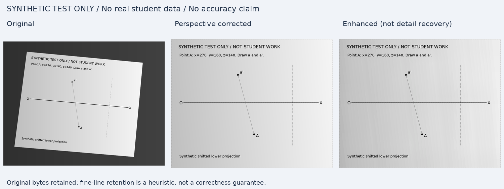

# 《画法几何及机械制图》AI 智能作业批改 Demo v0.1

可以本地启动的 Python / Streamlit 验证程序。OpenCV + Pillow 做非破坏性图像处理；视觉模型完成题意分析与逐项评估；Pydantic 在后端检查结构、范围、引用和分数合计。

**所有批改结果均为 AI 建议，待教师复核，不是教师正式评分。** 单次作业的知识点评估只是本题局部表现，不代表长期掌握度。本项目没有测量或宣称真实作业批改准确率。

## Windows 安装和启动

建议安装 Python 3.11 或 3.12（最低 3.10），在解压后的项目目录打开 PowerShell：

```powershell
py -3.12 -m venv .venv
.\.venv\Scripts\python.exe -m pip install --upgrade pip
.\.venv\Scripts\python.exe -m pip install -e ".[test]"
Copy-Item .env.example .env
.\.venv\Scripts\python.exe -m streamlit run app.py --server.address 127.0.0.1
```

若电脑只有一个 Python，可将第一行改为 `py -m venv .venv`。不需要运行 Activate.ps1 或修改 PowerShell 执行策略。之后也可以双击 `start_windows.bat`。浏览器访问 **http://127.0.0.1:8501**。请从项目根目录启动。

macOS / Linux：

```bash
python3 -m venv .venv
.venv/bin/python -m pip install -e '.[test]'
cp .env.example .env
.venv/bin/python -m streamlit run app.py --server.address 127.0.0.1
```

只运行界面也可安装 `pip install -e .`；自动化测试需要 `[test]`。关键依赖及实际验证版本见 `pyproject.toml` 和 `docs/requirements-tested.txt`。

## API 配置

在本地 `.env` 中设置，或使用同名进程环境变量（进程变量优先）：

```dotenv
OPENAI_BASE_URL=https://api.openai.com/v1
OPENAI_API_KEY=
OPENAI_MODEL=
```

自行在本地填入密钥及服务商明确支持视觉输入的模型名，不要把密钥粘贴到聊天、源码或报告中。`.env` 已加入忽略列表。兼容服务的地址应包含其 API 前缀，如 `/v1`，程序追加 `/chat/completions`。不能仅凭“OpenAI-compatible”推定其模型支持视觉。

未配置时，页面会列出缺失字段，仍可上传和预处理图片，也可显式切换 **Mock 流程测试（固定响应）**。真实 API 失败会显示错误，绝不自动切换 Mock。界面“配置齐备”只表示字段齐全，不代表已验证网络、权限或视觉能力。

可配置超时、重试、输出 token 和图像预算，详见 `.env.example`。默认 `AI_RESPONSE_FORMAT=json_object`；支持严格结构化输出的服务可使用 `json_schema`，不支持 `response_format` 的服务可显式使用 `none`。三种方式均执行相同后端 Schema 和业务校验，失败会保留原始响应，不补造评分。接口使用同步 Chat Completions，未实现 Responses API 专有协议。

## 使用流程

1. 在 A 题目、B 标准答案、C 学生答案三个独立区域上传 JPG/JPEG/PNG。每类最多 6 张，每张不超过 20 MiB / 2400 万像素；不支持 PDF。B 和 C 的图片角色从上传区确定，不依赖文件名。
2. 对照原图、矫正图、增强图，调整亮度、CLAHE、轻度去噪、锐化和方向。自动框不可靠时保留原图；可手动矩形裁切或输入四角像素坐标。手动坐标基于 EXIF 校正后的原图，先裁切/透视再旋转。输入错误会明确回退。任何一张上传图无法处理时，批改按钮会禁用，避免漏页后继续批改。
3. 可补充题目文字、参考答案说明、教师评分细则和匿名测试编号。教师规则优先；模型转为 10 分制后仍需教师核对。
4. 点击“分析题目与标准答案”。阶段 A **不发送学生图**，返回任务、关键关系、作图步骤、必需结果、替代方法、知识点和细则。
5. 编辑界面中的题目分析、知识点和评分细则 JSON，然后点击确认。满分必须为 0.5 的倍数且合计严格为 10。每个知识点都要关联评分项。确认会生成细则摘要和时间，供报告核对。
6. 点击“开始 AI 批改”。阶段 B 发送三类图片、必要原图/增强图、已确认细则和图像质量记录，逐项判断。默认同时发送原图与增强图；也可单独选择。
7. 查看建议总分、逐项证据和置信度、错误分类、具体修改步骤、知识点本题表现、复核原因；下载 JSON 和 Markdown。无法识别的项保留 `null`；任意项无法判分时，总分也为 `null`，不会将未知项计为零。

题目/参考图、补充材料、运行模式变化会使分析和确认失效；学生图变化会使报告失效；编辑已确认细则会要求重新确认。界面显示的置信度为模型自报，**未经统计校准**。没有可靠错误定位能力，v0.1 仅显示文字描述，不输出坐标框。

## 无 API 的完整流程测试

界面选择“Mock 流程测试（固定响应）”，勾选“未上传区域使用程序生成样例”，依次点击分析、确认、开始 Mock 测试。Mock 明示使用固定 JSON，不识别图片，固定的 5.5 分仅用于验证数据链路；换成其他图也不会变成真实评分。修改细则 ID/分配后，固定 Mock 可能触发预期的交叉校验错误。教师补充规则不会由固定 Mock 理解，若 Mock 未采用教师规则，程序会显式拒绝。

Mock 场景还包括无法辨认（返回 null）、API 错误和损坏 JSON。JSON 失败后可查看/下载原始响应并重新生成。

命令行生成样例、Schema、完整报告和图像对比：

```powershell
.\.venv\Scripts\python.exe scripts/generate_samples.py
.\.venv\Scripts\python.exe -m scripts.export_demo
.\.venv\Scripts\python.exe -m pytest -q
```

`sample_data/` 所有图片均由程序生成，不是真实学生作业。完整示例：`sample_data/example_report.mock.json` 与 `.md`，元数据包含 `is_mock: true`。评分由受控 fixture 提供，没有经过视觉推理。

## 图像处理效果

下图展示程序生成投影线图加入透视和光照变化后的处理结果。原始字节保留在会话内，不覆盖上传原图。该图只证明处理链路可运行，不能证明作业识别准确率。



独立图片及质量记录：`docs/preprocessing_original.png`、`preprocessing_corrected.png`、`preprocessing_enhanced.png`、`preprocessing_quality.json`。

检测要求较大的凸四边形和可信内外亮度差，避免将小作图框误认为整张纸。只按外框裁去背景，不做图线内容包围框裁切。方向处理包括 EXIF 方向、证据一致时轻度水平纠偏，以及手动 90/180/270° 旋转。无法可靠判断上下颠倒或语义方向，必须人工核查。错误检测可通过“保留完整原图”关闭。

增强使用温和 CLAHE、保边去噪、可调锐化，并保护可检测的细笔画，不做生成式修复。清晰度是拉普拉斯方差参考值；细线保留率是矫正图与增强图的像素启发式，不能保证所有细线均可辨认，也未覆盖透视/发送缩放损失。发送时优先 PNG，超预算才使用高质量 JPEG 和缩放，实际 MIME、尺寸、哈希保存在输入清单中。请求超预算明确报错，不静默遗漏图片。

## 工程结构

```text
app.py                     中文 Streamlit 页面、会话失效控制
src/preprocessing/         图像解码、边框检测、透视、旋转、增强和质量日志
src/ai/                    提示词、知识点目录、图片编码、真实 API、显式 Mock
src/grading/               两阶段编排、教师确认和报告交叉校验
src/schemas/               严格 Pydantic 模型及分数/引用约束
src/reporting/             JSON 和 Markdown 导出
src/utils/                 环境配置、最小本地审计
tests/                     图像、Schema、API、集成、Streamlit 测试
scripts/                   程序生成测试数据与交付证据
sample_data/               合成线图、固定响应和完整 Mock 报告
docs/                      Schema、对比图、测试证据、手工验收步骤
```

业务模块不依赖 Streamlit。未来可以通过 FastAPI 等封装 `GradingService`、`confirm_analysis` 和 Pydantic Schema，再供 Next.js 使用；本版不引入 Next.js、认证、班级数据库或生产部署。

## 校验与实际测试

执行：

```powershell
.\.venv\Scripts\python.exe -m pytest -q --junitxml=docs/test-results.xml --cov=src --cov=app --cov-report=term-missing
.\.venv\Scripts\python.exe -m ruff check .
```

覆盖透视矫正、失败回退、细线/虚线/点划线、手动方向/裁切、EXIF、真实 MIME、请求预算、严格 JSON Schema、评分范围/合计/引用、无法识别、缺少图片、HTTP 错误、超时/重试和原始响应保留；使用受控响应覆盖两个阶段的真实 HTTP 适配器与独立 Mock；Streamlit AppTest 实际操作确认与批改按钮并验证旧结果失效。

实际执行结果和环境见 **`docs/TEST_RESULTS.md`**、JUnit XML、测试文本日志及页面截图。真实视觉模型的人工验收流程见 **`docs/REAL_MODEL_TEST.md`**。自动化通过不代表真实模型评分正确；真实视觉验收未执行时须如实记录。

## 数据记录与局限

默认原图、处理图、模型原始响应只在当前 Streamlit 进程/会话及预处理内存缓存中；原文件名不进入 API。模型输入清单记录角色、版本、MIME、尺寸、字节数和哈希，不记录 base64。程序不自动保存学生图，不建立个人信息档案。下载报告由用户主动操作，匿名编号会包含在报告提交编号中。

`PERSIST_LOCAL_LOGS=true` 才写本地审计 JSON（含原始模型响应）；响应可能引用图片中的个人信息，开启前请匿名化并自行设置保存/删除规则。日志目录默认 `artifacts/`。清空按钮清理本应用会话记录和预处理缓存；已下载文件及已开启的磁盘日志需手动删除。不保证进程内存取证级安全擦除。本地界面默认仅绑定 127.0.0.1，无认证，不适合直接暴露公网。

v0.1 重点验证基础题链路，不能保证复杂机械制图、遮挡照片、超细标注、特殊符号、多题混排或严格尺寸测量的正确性。自动纸张边框可能误判，低质量图片或矫正误差必须人工检查；不会从照片像素距离直接推定真实尺寸。最多 18 张大图仍可能占用较多内存，建议每类 1–3 张清晰局部图；token 消耗取决于模型。

未来建议：建设经授权匿名化的教师标注数据集，按题型和图片质量分层评测；校准置信度与拒判策略；增加可靠几何/符号检测及可核验定位；教师复核回写；基于多次作业建立长期画像。生产化前再处理身份权限、隐私保存策略、队列任务和审计治理。
