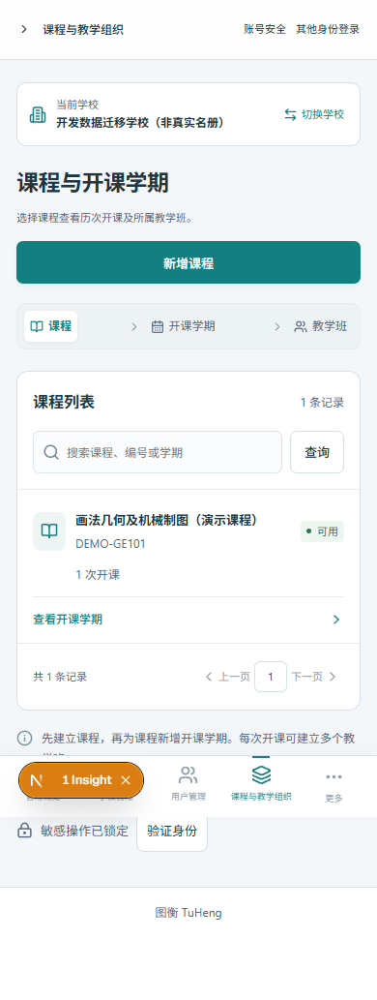
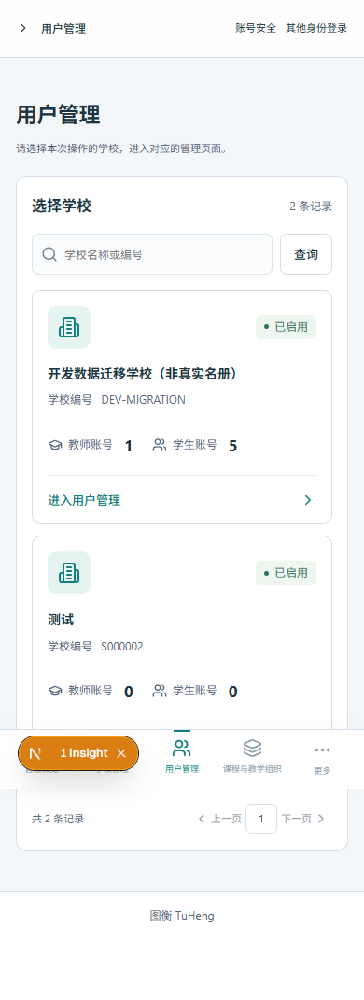

# 图衡 TuHeng


面向工程图学教学的作图、作业与反馈平台。学生使用几何编辑器或图片作答，AI 提供分析建议，教师复核并发布正式成绩。

基于 Next.js、TypeScript 和 PostgreSQL，使用独立 Node.js Worker、Redis 与 S3 兼容对象存储。

[开始运行](#本地运行) · [操作指南](docs/WORKFLOWS.md) · [文档目录](docs/README.md) · [部署与排障](docs/OPERATIONS.md)

## 当前功能

| 模块       | 能力                                                                                                                                                                   |
| ---------- | ---------------------------------------------------------------------------------------------------------------------------------------------------------------------- |
| 账号与学校 | 网站管理员、学校管理员、教师、学生四类账号；学生与管理端隔离登录；管理端支持登录 ID 或已验证邮箱共用输入框。建校自动创建首位校管，可追加多位，至少保留一位启用的校管。 |
| 教学组织   | 学校 → 课程 → 开课学期 → 教学班。支持同课程跨学期、同学生多班、联合授课与教师交接。开课学期和教学班按时间自动更新状态，课程、学期和班级可分别归档。 |
| 名单与凭据 | 学校四列、教师三列 Excel 导入；预览、确认、逐行处理与重试；复用已有学生账号；教师和学生初始凭据分别限时下载。                                                          |
| 用户中心与通知 | 四类身份的私有头像、邮箱与密码、个人邮件偏好、站内通知、截止提醒、正式成绩与申诉通知，以及按学校和班级范围发布公告。 |
| 私有文件 | 题库、作业、自测、错题、头像按稳定业务 ID 归档；新上传经暂存和后台校验。 |
| 作业与反馈 | 题目及细则版本、接收人发布快照、草稿与正式提交、评分任务、教师复核、成绩发布与申诉；保留自测和错题本。                                                                 |
| 几何编辑   | VHW 面投影、VH 两面投影、三视图和两种轴测图共用编辑器。支持统一展开图、几何构造与修改、工程标注、电子笔、图纸 JSON 与二维文本 DXF 交换。 |
| 作图教学   | 分步讲解与逐笔动画、独立动画 JSON 和 Schema、图纸格式审核、二维与三维联动预览。 |
| 后台配置   | AI 供应商、模型及模块调用规则，OpenAI Chat Completions / Anthropic Messages 适配；SMTP 版本管理、网站备案信息、任务诊断和审计。                                        |

三维预览适用于轮廓闭合、投影对齐且至少有两张正交视图的图纸。已验证长方体、阶梯块、圆柱和显式贯通孔。轴测图可做基础格式审核。照片提取几何、OCR、DWG 和实时协作属于后续范围。图片上传与作答沿用现有流程。[编辑器操作指南](docs/GEOMETRY_EDITOR_INTERACTION.md) · [分步动画示例](docs/GEOMETRY_EDITOR_ANIMATION_SCHEMA.md)

## 界面预览

以下为实际开发页面截图，数据为测试数据。


<details>
<summary>学校选择与手机界面</summary>





</details>

## 本地运行

需要 Node.js 22+、npm、PostgreSQL、Redis 和私有 S3 兼容存储。依赖版本以 [package-lock.json](package-lock.json) 为准。已有 PostgreSQL、Redis 或外部 S3 时可直接配置使用；**有可用 S3 桶就不需要另装 RustFS**。

1. 安装依赖，并将 [.env.example](.env.example) 复制为 `.env`。

   ```sh
   npm ci
   ```

2. 在 `.env` 配置数据库、Redis、S3，以及独立随机的 `AUTH_SECRET`。S3 桶应设为私有，并允许应用读取桶状态和读写业务对象。示例凭据仅用于本地 Compose。

   尚未安装依赖服务时，可使用仓库的 [compose.yaml](compose.yaml)：

   ```sh
   docker compose up -d
   ```

   Compose 中名为 `minio` 的服务实际运行 RustFS。首次启动后创建与 `S3_BUCKET` 一致的私有桶；已有服务时跳过 Compose，避免端口冲突。

3. 为新安装初始化数据库和管理员。

   ```sh
   npm run db:generate
   npm run db:migrate
   npm run identity:secrets -- --initialize
   npm run identity:bootstrap -- --output .runtime/admin-delivery.txt
   ```

   管理员登录 ID 固定为 `admin`，随机临时密码写入本机受限文件，不存在公开默认密码。交付后删除该文件。已有数据库更新请按[升级与迁移说明](docs/OPERATIONS.md#升级现有实例)操作，勿重复初始化账号。

4. 分别在两个终端启动网页与任务进程。

   ```sh
   npm run dev
   ```

   ```sh
   npm run worker
   ```

访问 [管理端登录](http://localhost:3000/login/staff) 或 [学生登录](http://localhost:3000/login/student)。管理员首次改密后可直接进入后台，邮箱绑定为可选；学校管理员与教师还须验证绑定邮箱，因此启用师生流程前应在后台配置 SMTP。

平板通过局域网访问时，在 `.env` 中设置 `APP_ALLOWED_ORIGINS=http://本机局域网IP:3000` 并重启网页服务。详见[局域网与登录排障](docs/OPERATIONS.md#局域网开发与平板访问)。

S3 默认使用私有代理读取（`S3_PUBLIC_ACCESS=false`）。阿里云 OSS + ESA 可用 `S3_ENDPOINT=https://s3.oss-cn-hangzhou-internal.aliyuncs.com` 和 `S3_FORCE_PATH_STYLE=false` 连接 OSS。在 ESA 已限制读取范围的部署，可开启 `S3_PUBLIC_ACCESS=true` 并设置 `S3_PUBLIC_READ_BASE_URL=https://assets.example.com`，为授权后的已归档编辑图与头像变体提供加速地址。[S3 配置与验收](docs/OPERATIONS.md#阿里云-oss-与-esa-读写分离)

没有真实模型凭据也可运行编辑器、提交和人工复核。未配置的 AI 任务会明确阻塞，不会产生模拟成绩；配置方法见 [AI 与邮件服务](docs/AI_CONFIGURATION.md)。

旧开发库已有附件时，在应用最新迁移前先运行开发资源切换的预检。新环境直接初始化。存储目录、通知规则和账号操作见[私有资源、用户中心和通知](docs/RESOURCES_NOTIFICATIONS.md)。

## 从建校到教学

网站管理员建校并交付校管账号 → 校管建立课程及开课学期 → 校管安排教师，或教师在本校可用开课下建立自己的教学班 → 导入/关联学生 → 出题与发布作业 → 学生作答 → 教师复核并发布成绩。

用户管理维护学校级账号身份；教学组织维护课程、开课和班级关系。退班不会停用学生账号，换学期不会重建学生密码。学校范围、资源授权和正式复核权限分别校验，详见[权限矩阵](docs/PERMISSIONS.md)和[完整操作路径](docs/WORKFLOWS.md)。

## 开发与验证

```sh
npm run typecheck
npm run lint
npm test
npm run test:integration
npm run build
npm run test:e2e
```

集成与浏览器测试必须使用隔离的数据库、Redis 队列和对象存储桶，不能直接连接业务实例。测试环境准备、关键用例和实际验证范围见 [TESTING](docs/TESTING.md)。

模块职责见 [ARCHITECTURE](docs/ARCHITECTURE.md)，数据迁移见 [DATABASE](docs/DATABASE.md)。二维 CAD 的操作、图纸格式及浏览器验收见[编辑器指南](docs/GEOMETRY_EDITOR_INTERACTION.md)、[几何契约](docs/GEOMETRY_EDITOR_SCHEMA.md)和[实际验收](docs/CAD_REFERENCE_ALIGNMENT.md)。贡献修改前请阅读 [AGENTS.md](AGENTS.md)。
