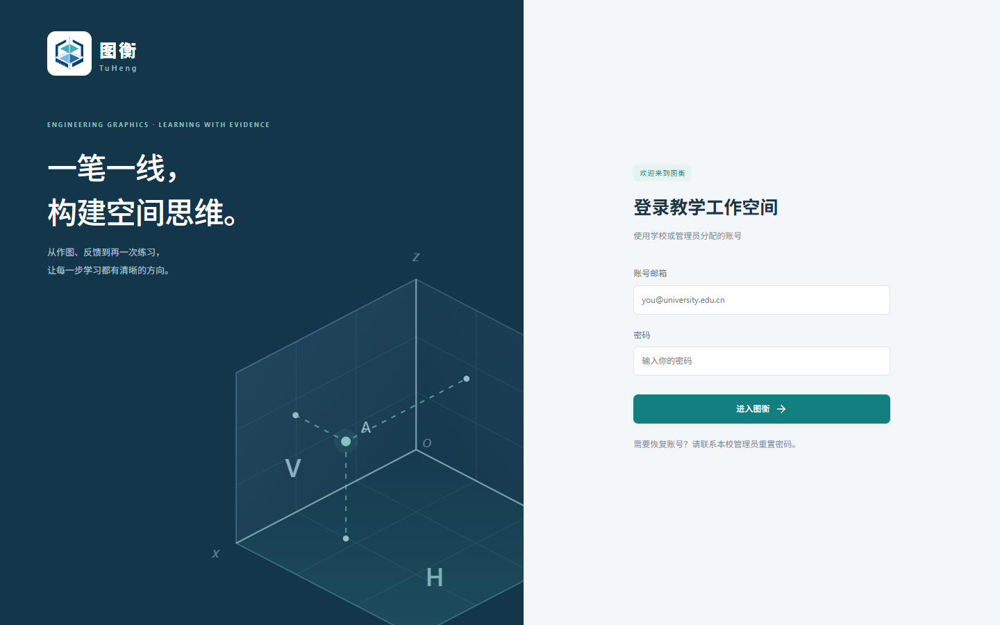

# 图衡 TuHeng


工程图学教学闭环。Next.js + TypeScript 模块化单体，独立 Node Worker 与可替换视觉评分核心。

几何编辑器支持 VHW、三视图、正等轴测和斜二等轴。登录后访问 `/geometry` 独立作图，或在教师建题时选择几何作答方式。升级需执行 `npm install`、`npm run db:generate`、`npm run db:migrate`。使用与契约见 [几何编辑器架构](docs/GEOMETRY_EDITOR_ARCHITECTURE.md)。

VHW 与三视图现在采用同一张展开图纸、共享原点和镜头。拖动就地显示长度/角度，点可吸附到基准轴/原点/换面轴；默认选择支持 Window/Crossing 框选，对象附近可精确编辑。平行/垂直构造和方向关系共用内核，端点合并真实引用，电子笔拟合与原笔迹恢复保留。新增参考关系使用 2.1，插值曲线使用 2.2，兼容 v1/2.0/2.1 与历史任务。交互、权限、截图/JSON 及设备验证范围见 [UX v2 验收](docs/GEOMETRY_EDITOR_UX_V2.md)。

## 几何编辑与教学流程

- 四种编辑器共用版本化 `GeometryDocument` 和运行时校验，提供点、实/虚线段、无限辅助线、圆/圆弧、过点曲线、新投影轴与换面、端点连接、投影关联、属性编辑和撤销恢复。
- 「线工具 → 曲线」（手机「绘图 → 曲线」）：先选两端点，依次标记经过点，再点任一端点并确认；附近直线/轴交点自动吸附。
- 电子笔直接采集轨迹，松手自动拟合直线、圆、圆弧或平滑开放曲线；曲线靠近交点自动定位，支持取消吸附、恢复原笔迹及三种线型。失败保留笔迹；支持虚拟直尺、触控平移和缩放。
- 教师题目保存冻结版本；学生可保存几何草稿、提交独立作答快照，通过现有队列和评分核心进入教师复核。图片作答继续保留。
- 支持 JSON、中文关系描述和 SVG 导出。照片识别导入属于下一轮，未来仍使用同一文档接口。

文档：[架构与组件](docs/GEOMETRY_EDITOR_ARCHITECTURE.md) · [数据契约](docs/GEOMETRY_EDITOR_SCHEMA.md) · [交互说明](docs/GEOMETRY_EDITOR_INTERACTION.md) · [评分接入](docs/GEOMETRY_EDITOR_AI_EXPORT.md) · [四份 JSON 示例](docs/geometry-examples) · [交付与验证记录](docs/DELIVERY.md)。

品牌图标统一使用几何 SVG。登录页以 H 水平底面、V/W 竖直面构成投影装饰，桌面端放大至左侧面板右下角，由右侧登录区域遮去部分边缘；手机端保留紧凑布局。



## 本地运行

Node 22+、Docker Compose。复制 `.env.example` 为 `.env`，设置 AUTH_SECRET 和 SEED_PASSWORD（至少 12 字符）。

```sh
npm ci
docker compose up -d
npm run db:generate
npm run db:migrate
npm run db:seed
npm run dev
# 另一个终端
npm run worker
```

访问 http://localhost:3000 。测试账户 student@tuheng.local、teacher@tuheng.local、admin@tuheng.local 使用 SEED_PASSWORD。seed 仅本地显式执行，数据标记为演示。

平板通过局域网访问时，在 `.env` 增加 `APP_ALLOWED_ORIGINS=http://本机局域网IP:3000`，重启 `npm run dev`，在平板打开该地址。`NEXTAUTH_URL=http://localhost:3000` 可保留供本机使用；多个受信任地址用逗号分隔，必须包含协议和端口，不使用通配符。IP 变化后需更新配置。开发资源、登录跳转和保存接口共用这些应用地址；操作与排查见 [局域网开发与平板访问](docs/OPERATIONS.md#局域网开发与平板访问)。

未配置视觉 API 时仍能提交、人工复核与发布，任务明确显示配置阻塞；不会生成模拟分。配置 AI_API_KEY、AI_BASE_URL、AI_MODEL、AI_OUTPUT_MODE 后在任务页面重试。真实调用不会使用测试 Mock。

```sh
npm run typecheck
npm run lint
npm test
npm run test:integration
npm run build
npm run test:e2e
```

架构与权限见 docs/。实际完成/限制、精确测试结果与下一步见 docs/DELIVERY.md。

配置真实视觉服务后执行 `npm run model:sync`，再重启 Web/Worker。旧任务沿用旧配置，可在管理页选择“使用当前配置新建运行”。详见 [运行与恢复](docs/OPERATIONS.md)。

Playwright 首次使用先 `npx playwright install chromium`；已有系统 Chromium 时可用 `PLAYWRIGHT_CHROMIUM_PATH=/usr/bin/chromium npm run test:e2e`。集成测试应在隔离测试数据库运行；本地验收时先停止普通 Worker，避免它抢占测试任务。

本环境本地演示账户初始密码为 `TuHeng-Dev-2026!`（仅本地测试）。自行安装时使用 `.env` 中配置的 SEED_PASSWORD；不要在正式环境复用演示账号或密码。
