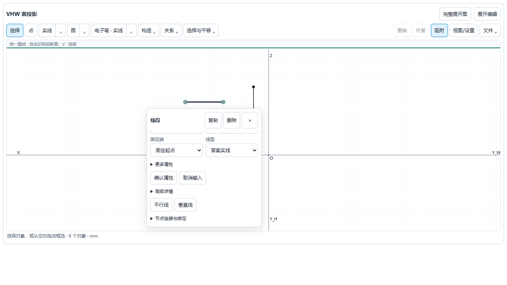

# 几何编辑器操作指南

[返回文档目录](README.md) · [JSON 契约](GEOMETRY_EDITOR_SCHEMA.md) · [实现架构](GEOMETRY_EDITOR_ARCHITECTURE.md)

登录后访问 `/geometry` 独立作图并导出本地文件；在题目和作业中使用时，几何文档经既有草稿、提交和复核流程保存。图片作答仍可使用。

## 图纸与投影归属

四类图纸共用绘图内核：VHW 面投影、三视图、正等轴测、斜二等轴。

VHW 和三视图使用同一张展开图纸、统一毫米比例和镜头。V 在左上、H 在下方、W 在右方；X 向左、Z 向上、Y_H 向下、Y_W 向右。新图形按落笔位置自动识别投影面；多步绘制锁定首次确定的框架，不再手动切换 V/H/W。拖动已存在对象跨轴不改变其投影归属。

“完整展开图”调整镜头以显示整张图纸，不重排投影。三视图可以隐藏点名，但内部点身份仍保留。轴测图的尺寸默认表示图纸长度，不推断未知空间实长。新建斜二等轴默认 x 向右、z 向上、y 向左下，深度比例 0.5；历史显式参数保持原值。

## 工具入口

| 入口               | 内容                                                   |
| ------------------ | ------------------------------------------------------ |
| 选择、点           | 点击选择与点作图。                                     |
| 线工具             | 实线、虚线、无限辅助线、过点曲线。                     |
| 圆与圆弧           | 圆心/半径作圆，指定圆弧。                              |
| 电子笔、电子笔线型 | 松手自动拟合；选择实线、虚线或辅助线。                 |
| 构造               | 平行线、垂直线、辅助线、新投影轴。                     |
| 关系               | 连接两点、投影关联、已有线的平行/垂直调整。            |
| 选择与平移         | 平移、明确框选等替代操作。                             |
| 视图/设置          | 图层、标签、网格、坐标、吸附细项、参考轴过滤、虚拟尺。 |
| 文件               | JSON / 笔迹导入，JSON / 中文描述 / SVG 导出。          |

窄容器中工具合并为绘图等分组，属性使用就地摘要和展开面板。全屏使画布占用工具栏和状态区之间的空间；布局按容器宽度调整，不依赖把手机强制横屏。

## 选择、拖动与框选

| 操作                | 结果                                         |
| ------------------- | -------------------------------------------- |
| 点击对象            | 选中并显示对象附近属性卡；鼠标移开不会关闭。 |
| 拖点、线段端点      | 实时移动点或拉伸端点，相关图形共同更新。     |
| 拖线身、已选对象组  | 平移对象/选集，共享节点只处理一次。          |
| 选择模式从空白拖动  | 直接矩形框选，不必先切工具。                 |
| 左向右框选          | Window：只选完全包含的对象。                 |
| 右向左框选          | Crossing：选包含或与边界相交的对象。         |
| Shift 点击/框选     | 加入现有选择。                               |
| Ctrl/Cmd 点击       | 切换目标的选中状态。                         |
| 空格拖动 / 平移工具 | 移动镜头，不改几何对象。                     |

基准轴默认不进入普通框选/删除集合，可通过参考轴过滤器包含；隐藏图层不参与普通选择。无限辅助线无法被有限窗口完全包围，Window 默认不选，Crossing 按真实相交判定。多投影选集按统一图纸位移换算各自局部位移，不改变 viewId。

每次拖动只提交一条历史。移动期间显示预览，松手校验并提交；取消、失焦、异常捕获丢失或外部文档变化撤回未提交操作。正常捕获允许拖出画布再松手。

## 实时尺寸与对象属性

新建线段、拉伸端点时，线附近实时显示灰色长度和角度；圆/圆弧显示相应半径。数值来自吸附之后的预览几何，松手前即可看到，不依赖滚到属性区。HUD 不写入答案或导出文件。

属性卡顶部始终提供对象类型/数量、复制、删除、关闭，正文单独滚动。复制是在当前文档内建立副本，不是系统剪贴板。只读或有依赖冲突的操作会禁用并说明原因。

常用参数直接显示：点名/必要坐标，线段长度/角度/线型，圆或圆弧半径；端点坐标、节点引用、绑定及技术详情按需展开。线段可选择固定起点、终点或中点。

输入允许空串、负号、小数点等草稿，Enter/确认才验证并提交一次；Esc/取消不写入。无修改确认不增加空历史。单选、多选使用角色允许的共同线型，不能把教师题干变成学生答案。输入框的删除和撤销快捷键仍用于文本编辑。

## 吸附、绑定与合点

默认吸附按 CSS 像素计算范围，包含已有端点、原点、交点、真实基准轴/新增轴、网格及方向参考。轴显示和轴吸附、网格显示和网格吸附分别设置；隐藏轴不参与吸附。拖动沿轴移动时持续重算最近点，不锁死在上一次位置。

“贴到轴上”把点定位到实际轴的垂足；“沿轴方向”只约束本次作图方向。没有绘图起点的独立点也能吸附到原点或轴。

同投影端点接受重合吸附会真正合并规范点引用，相关线段/圆心/曲线引用共同更新；撤销可恢复原来的两点与引用。不同投影的对应点只能关联，不能合成同一节点。题干点可作只读锚点。

| 操作               | 保留与撤回内容                                  |
| ------------------ | ----------------------------------------------- |
| Alt / 暂停当前吸附 | 本次使用原始位置，下次恢复全局设置。            |
| 取消本次吸附       | 保留原始拖动/绘制，只撤回自动定位及其拓扑变更。 |
| 撤销               | 撤回完整操作及引用、依赖变化。                  |
| 恢复原始笔迹       | 撤回拟合，恢复采样轨迹。                        |

开始下一次文档编辑后，旧“取消本次吸附”失效；选择、查看和缩放不算新编辑。吸附到轴默认是一次定位，显式开启“保持贴轴/绑定到轴”才持续维护关系。

## 平行、垂直与换面轴

新建构造线可从“构造”选择平行/垂直，再选参考线或轴、通过点、确认预览；也可先选对象，从属性卡选择过点作平行/垂直线。参考对象不移动，通过已有点时复用或绑定该点。有限实/虚线默认 10 mm 可改，无限辅助线没有假长度。

调整已有线方向时先选参考再选待修改答案线，默认保持目标起点与长度，预览确认后形成一次历史。共享端点、只读锚点或绑定冲突会拒绝并解释。同投影或明确图纸辅助几何内计算，不能把跨投影的屏幕平行当作空间平行。“保持关系”是显式有向依赖，拒绝循环；不勾选则只做本次方向调整。

新投影轴从“构造 → 新增投影轴”进入：

1. 选择父投影系、保留面、替换面和名称。
2. 普通轴两点定位；平行/垂直轴先选参考线，再确定通过位置。
3. 点击轴的一侧，检查展开区后确认。
4. 在新框架继续作图；可将新轴作为下一次换面的父系。

创建轴不会自动补出正确答案点。题目允许时学生可新增轴；名称与删除受权限和依赖限制。轴几何定义不提供直接重定义，避免静默挪动已有答案。连续换面使用真实换面关系，拒绝依赖环；轴测模式不使用此正投影入口。

## 电子笔

直接绘制，松手后自动尝试直线、圆、圆弧或平滑开放曲线，无需点击确认。可靠圆保存为带圆心/半径的 `circle`，不是看似圆的折线。不可靠轨迹保留原笔迹，椭圆、乱线、“8”字不会无条件强制变圆。

三种线型共用识别：实线/虚线的直线生成有限线段，辅助线笔迹只要可靠拟合为直线，即使画得短也生成真正无限辅助线。辅助曲线仍为有限曲线，不无限外推。

开启吸附和参考轴吸附时，已拟合直线跨度至少 12 CSS px、与真实参考轴方向相差不超过 7.5°，会自动校正方向。V/H/W 中接近水平、垂直的笔画因此得到精确方向；不把整条线搬到基准轴上，也不自动建立持续绑定。明确端点优先，不能为了水平/垂直而移动蓝色锚点。关闭吸附或本次暂停可保留自由方向，虚拟尺导向笔画不再额外推断轴方向。

拟合使用手势开始时的比例和坐标变换，保留最终落点、压力及原始 samples。去抖、等弧长采样和几何误差检查共用既有 fitter；失败保留轨迹，成功可恢复原笔迹。虚拟尺只作为输入工具，不计入答案。

## 过点曲线

1. 桌面选择“线工具 → 曲线”，手机选择“绘图 → 曲线”。
2. 先选两个端点，可复用同投影已有点或点空白新建。
3. 按从第一端点到第二端点的路径顺序标记至少一个经过点。附近辅助线/线段/轴的实际交点会预览吸附。
4. 点击任一端点结束标记，检查预览后按“确认曲线”。选择第一端点结束只反转保存顺序，不改变形状。

曲线经过每个正式点；移动经过点实时更新曲线。确认前仅保存会话草稿，取消/切换工具不污染正式文档。可撤回上一点、取消曲线或撤销整次创建。

电子笔可直接拟合开放平滑曲线，附近直线交点可定位为经过点；取消吸附恢复未吸附曲线，恢复笔迹回到原轨迹。闭合样条、曲线求交和复杂参数化求解器不在当前功能内。

## 触屏、快捷键与导出

选择模式下单指选中/拖动对象或从空白框选；双指平移缩放。笔模式下手指默认平移，可显式启用手指绘图；有可见平移工具和两次点击框选替代操作。按浏览器暴露的指针能力抑制额外掌触，不承诺硬件级防误触。

Esc 逐层取消输入/弹层、当前操作、当前工具。Ctrl/Cmd+Z 撤销，Shift+Ctrl/Cmd+Z 或 Ctrl/Cmd+Y 重做；快捷键仅作用于当前获得焦点的编辑器，文本输入和输入法组合输入保留原生行为。

JSON、中文描述和 SVG 从同一模型导出；不含镜头、HUD、选中框、菜单和输入草稿。导入先校验，非法数据不会覆盖当前图形。普通历史读取保留版本，新增编辑副本按需要升级。照片识别导入尚未实现。

鼠标真实路径、触控/笔模拟与真实设备验收分别记录，见[测试指南](TESTING.md)。
