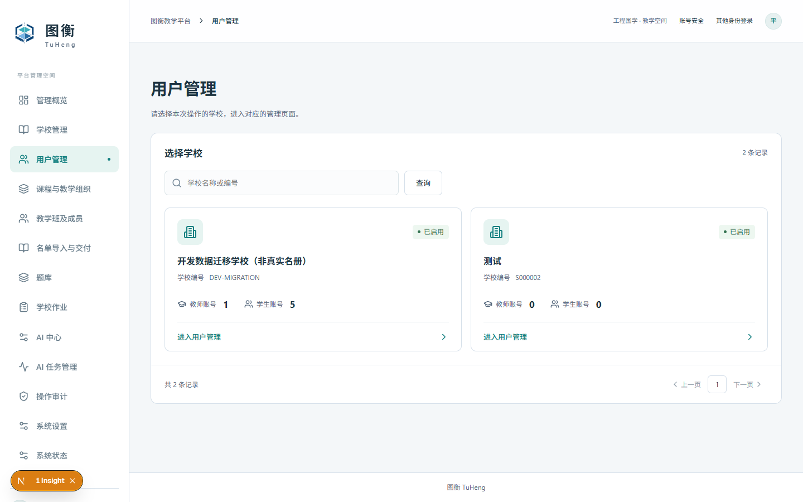
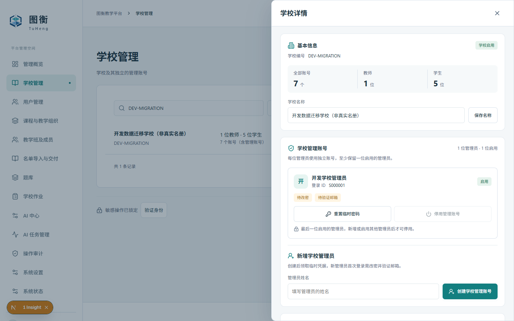
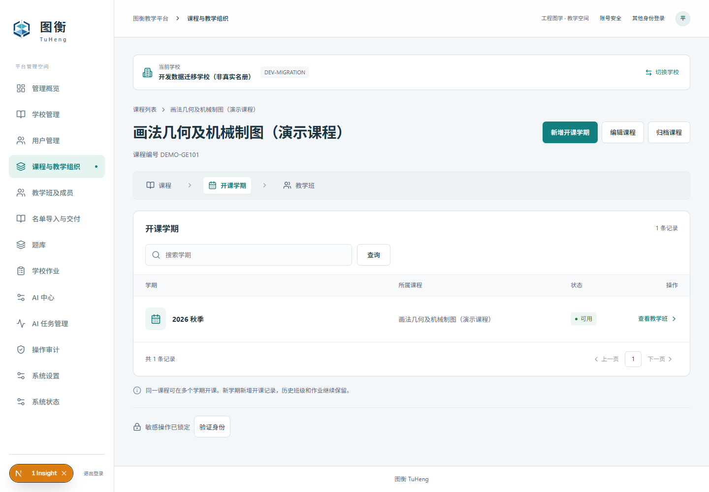

# 教学管理操作指南

[返回文档目录](README.md) · [权限矩阵](PERMISSIONS.md)

## 组织关系

```text
学校
├─ 学校管理员（可多位，至少一位启用）
├─ 教师、学生账号（人员归属学校）
└─ 课程：工程制图
   ├─ 开课安排：2026 秋
   │  ├─ 教学班：制图一班
   │  └─ 教学班：制图二班
   └─ 开课安排：2027 春
      └─ 教学班：制图一班
```

学期名称属于某一课程的开课安排，不是全平台统一的上级集合。“工程制图 · 2026 秋”和“机械设计 · 2026 秋”是两次开课。同一课程可以有多个学期，同一次开课可以有多个班。

学生通过成员关系加入班级；教师通过授课授权负责班级。同一学生或教师可以关联多个班，不因换班、换课程或换学期创建新账号。

## 各入口负责什么

| 入口                                    | 主要用途                                         |
| --------------------------------------- | ------------------------------------------------ |
| 网站管理员 → 学校管理                   | 建校、维护学校状态、查看及追加独立学校管理员。   |
| 网站管理员 → 用户管理 / 校管 → 人员管理 | 维护学校级教师、学生身份、学号、姓名和账号状态。 |
| 课程与教学组织 / 课程与开课学期         | 管理课程、已有课程的开课学期、归档与恢复。       |
| 教学班及成员 / 教师的我的教学班         | 管理具体班级、当前成员及授课关系。               |
| 名单导入与交付 / 导入与交付             | 导入成员名单，跟踪逐行结果，安全交付初始凭据。   |

网站管理员进入用户、课程、班级或学校作业前先选择学校；页面顶部显示当前范围。学校管理员的学校由会话锁定，不能任意切换。学校、搜索和分页保存在 URL；课程与班级详情可直接打开对应链接。



## 建校与管理多位校管

1. 网站管理员进入 `/admin/schools`，完成近期身份验证后新建学校。
2. 建校同时生成首位独立 `SCHOOL_ADMIN`、临时凭据及审计；通过限时凭据入口交付。
3. 展开学校详情，使用“创建学校管理账号”追加管理员。每个账号都有独立登录 ID、临时密码及首次设置状态，不将教师转换为管理员。
4. 校管首次登录改密并验证邮箱。网站管理员自身仅强制首次改密。
5. 网站管理员可以重置、启用或停用校管，但不能停用最后一个启用的校管。旧学校缺少账号时保留补建入口；停用学校可先补建/启用校管，再恢复学校。

“至少保留一位”的规则只统计本校启用的校管。新增与启停由服务器在事务中检查，多个请求并发也不能绕过最少保留规则。

学校详情分为基本信息、学校管理账号和学校访问状态。每位管理员的卡片分别显示登录 ID、启停、改密和邮箱验证状态；重置密码后，可直接从当前卡片进入“领取初始凭据”。新增账号与停用学校分开放置，最后一位启用管理员的停用按钮会说明禁用原因。



手机使用全宽详情面板，操作按钮至少 44px 高，长姓名和编号自动换行。修改名称后关闭面板，会提示继续编辑或丢弃修改。查看[手机版操作区](images/school-details-20261119/mobile-actions.png)和[平板布局](images/school-details-20261119/tablet.png)。

## 课程、学期与班级

1. 校管进入“课程与开课学期”，或网站管理员选校后进入“课程与教学组织”。选择“新增课程”，填写名称与业务编号，例如“工程制图 / EG01”。
2. 进入课程详情，选择“新增开课学期”，填写“2026 秋”。下一学期仍进入这门课程，追加“2027 春”；不要新建同名课程或把旧班移到新学期。
3. 同课程同学期重复创建返回冲突；不同课程使用相同学期名合法。
4. 进入开课详情新建班级并指定本校有效教师。教师也可在“我的教学班”中，选择本校未归档的课程和开课创建自己的班级，系统同时建立其授课授权。
5. 点击具体班级进入详情，管理学生成员、授课教师及导入入口。教师不能借此维护学校级课程或开课主数据。



课程详情路径为 `/{admin,school}/organization/{courseId}`；开课详情为其下的 `/offerings/{offeringId}`；班级详情为 `/{admin,school,teacher}/classes/{id}`。实际使用时替换占位符，网站管理员链接保留 `schoolId`。

## 学生成员与 Excel 导入

手动加入学生或导入时，同校同学号复用现有账号。学号按文本处理，保留前导零。教师导入遇到既有学生姓名不符时应核对，不静默覆盖全局姓名。

| 导入者                  | Excel 列，按模板顺序         | 向导中的上下文               |
| ----------------------- | ---------------------------- | ---------------------------- |
| 学校管理员 / 网站管理员 | 教师名、班级、学号、学生姓名 | 学校、课程和开课安排。       |
| 教师                    | 班级、学号、学生姓名         | 本校可用开课及本人授权范围。 |

下载当前模板 → 选择开课安排 → 上传文件 → 核对预览与错误 → 确认导入 → 查看逐行结果 → 交付新账号凭据。预览不创建账号，确认和 Worker 都会重新验证权限及归档状态。

同一文件用于不同合法开课可建立不同批次；同一操作者、学校、开课、模板和列映射下重试同一内容复用原批次及进度。已有学生换课程、换学期不重置密码。

从班级移除学生只删除该班成员关系。修改全局学号/姓名或停用整个学生账号，应交由网站管理员或本校校管在人员管理中处理。

## 初始凭据交付

通过“导入与交付”或 `/当前后台/delivery` 查看批次，教师与学生凭据分别下载，不能混成一份名单。敏感操作需近期验证当前密码。

- 批次交付窗口为 24 小时，临时密码通常 7 天内有效且首次使用必须修改。
- 下载票据 120 秒内有效且单次使用，服务器再次检查账号和凭据版本。
- 学校管理员凭据通过独立交付入口查看；界面短时显示并在失焦等情况下隐藏。
- 用户已改密、账号重置、凭据撤销或过期后，旧批次不能继续查询有效明文密码。需要时按授权重新生成临时凭据。

批次过期不等于账号被删除。不要将下载文件、明文密码或截图放到公开仓库。

## 归档与授课交接

课程、开课、班级分别归档。任一父级归档时，阻止该组织的新写入和新发布；不批量修改子级状态，恢复父级也不恢复曾单独归档的子级。既有发布作业仍按其快照、时间窗和权限继续提交、处理和复核。

在班级详情新增教师可保留联合授课；交接时明确交出者和接任者，保留其他教师授权。

| 数据                           | 班级关系变化的影响                                              |
| ------------------------------ | --------------------------------------------------------------- |
| 当前班级成员、授课关系         | 本次操作直接修改。                                              |
| 已有发布快照的接收人、复核教师 | 不随入班、退班、教师交接或归档自动重算。                        |
| 旧版无发布快照的作业           | 仍使用实时选课/授课关系，交接可能影响其权限；界面分别提示数量。 |
| 历史作答、评分和正式成绩       | 不因组织操作改写。                                              |

当前班级交接不等于历史作业批阅权交接。不要用重新解析当前名单的方式替换历史接收快照。

## 出题、提交、复核与自测

1. 教师或有权建题的管理账号在自己的题库中保存题目、参考答案和细则版本，确认后用于作业。
2. 创建草稿，选择接收人、复核教师与时间窗。发布时冻结题目版本、接收人和复核分派。
3. 学生在自己的作业中保存草稿，使用图片或几何编辑器作答；正式提交生成不可变作答版本和评分任务。
4. Worker 处理已有任务并生成 AI 建议；缺配置时明确阻塞，人工复核仍可继续。
5. 获授权教师检查证据、评分和批注，确认后发布正式成绩。再次运行 AI 不覆盖已发布成绩。
6. 学生查看已发布结果并可申诉；教师更正时追加决定并保留历史。私有自测和错题回练复用作答、上传及评分内核，但不成为正式作业成绩。

编辑器具体操作见[几何编辑器指南](GEOMETRY_EDITOR_INTERACTION.md)。
